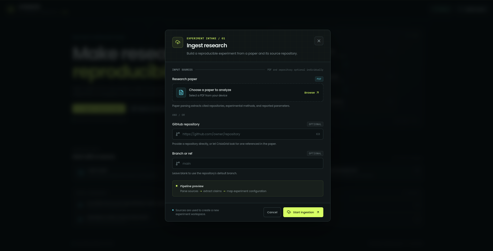
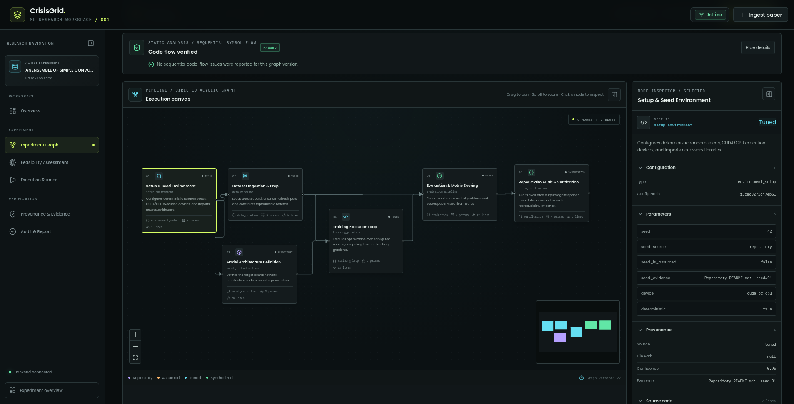
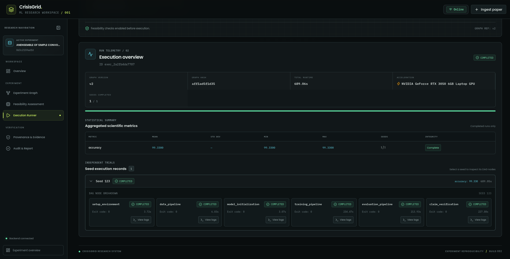

<div align="center">

<a href="https://github.com/PippyUrkel/NamespaceNotFound_college_round">
    
</a>

# CrisisGrid [App](#)

### Automated Machine Learning Experiment Extraction, DAG Synthesis, and Isolated Execution Platform

Extract scientific ML specifications from research papers and repositories, synthesize reproducible DAG pipelines, validate imports, and execute deterministic multi-seed runs inside isolated Docker containers with CUDA GPU acceleration.

<br>

[](https://python.org)
[](https://fastapi.tiangolo.com)
[](https://react.dev)
[](https://docker.com)
[](https://pytorch.org)
[](https://opensource.org/licenses/MIT)

</div>

## Features

- Ingest research papers in PDF format and GitHub repositories to extract structured experiment specifications.
- Parse multimodal scientific documents using Docling with fallback text extraction.
- Extract hyperparameter configurations, datasets, and target evaluation metrics with provenance tracking.
- Synthesize modular Directed Acyclic Graph (DAG) pipelines representing end-to-end ML workflows.
- Visual interactive node graph editor with live code editing and dependency propagation.
- Automated code normalization and sequential variable validation across pipeline nodes.
- Pre-flight import analysis and container environment preparation before execution begins.
- One-click Dockerfile export for reproducible execution across heterogeneous peer environments.
- Isolated Docker execution per node with memory, CPU, and process timeout enforcement.
- Hardware-accelerated execution with automatic NVIDIA GPU (CUDA) discovery and dual-mode passthrough.
- Deterministic multi-seed execution with automated seed injection across random number generators.
- Intermediate artifact caching with content-addressable hash keys for fast iterative testing.
- Aggregated statistical reporting across valid completed seeds with anomaly flagging.

## Documentation

Complete documentation, setup instructions, and feature walkthroughs are available here:

**https://github.com/PippyUrkel/NamespaceNotFound_college_round**

### Application Screenshots

<div align="center">
  
  <br><br>
  
  <br><br>
  
</div>

## Project Highlights

- Full-stack reproducibility engine for complex scientific machine learning pipelines
- Zero-loss provenance tracking connecting code and parameters back to paper evidence
- Hardware-adaptive execution supporting both GPU acceleration and CPU fallback
- Isolated container sandboxing preventing environment contamination
- Reactive web interface built with React 19 and XYFlow DAG canvas
- Resilient offline execution with local JSON persistence and artifact storage

## Contributing

Contributions, feature requests, and bug reports are welcome.
If you'd like to contribute:

1. Fork the repository.
2. Create a feature branch.
3. Commit your changes.
4. Open a Pull Request.

Please open an issue first if you'd like to discuss a significant feature or change.

## License

This project is licensed under the MIT License.

```text
MIT License

Copyright (c) 2026 PippyUrkel

Permission is hereby granted, free of charge, to any person obtaining a copy
of this software and associated documentation files (the "Software"), to deal
in the Software without restriction, including without limitation the rights
to use, copy, modify, merge, publish, distribute, sublicense, and/or sell
copies of the Software, and to permit persons to whom the Software is
furnished to do so, subject to the following conditions:

The above copyright notice and this permission notice shall be included in all
copies or substantial portions of the Software.

THE SOFTWARE IS PROVIDED "AS IS", WITHOUT WARRANTY OF ANY KIND, EXPRESS OR
IMPLIED, INCLUDING BUT NOT LIMITED TO THE WARRANTIES OF MERCHANTABILITY,
FITNESS FOR A PARTICULAR PURPOSE AND NONINFRINGEMENT. IN NO EVENT SHALL THE
AUTHORS OR COPYRIGHT HOLDERS BE LIABLE FOR ANY CLAIM, DAMAGES OR OTHER
LIABILITY, WHETHER IN AN ACTION OF CONTRACT, TORT OR OTHERWISE, ARISING FROM,
OUT OF OR IN CONNECTION WITH THE SOFTWARE OR THE USE OR OTHER DEALINGS IN THE
SOFTWARE.
```
